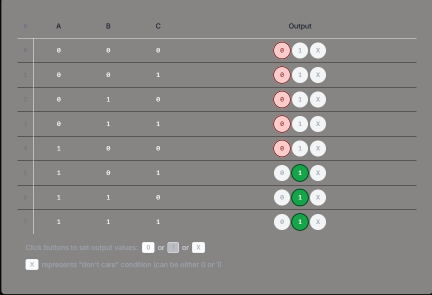
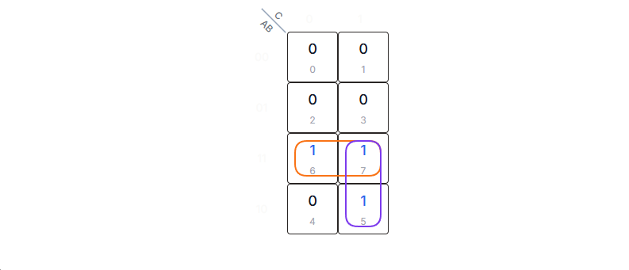
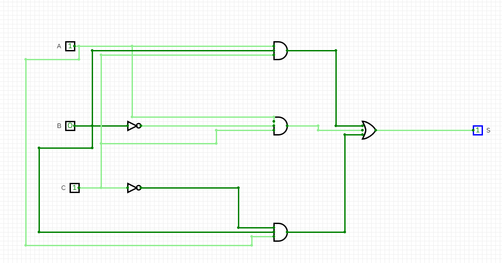
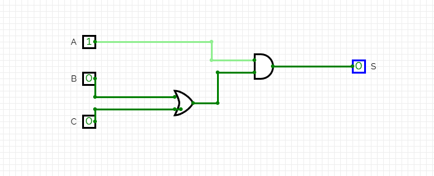
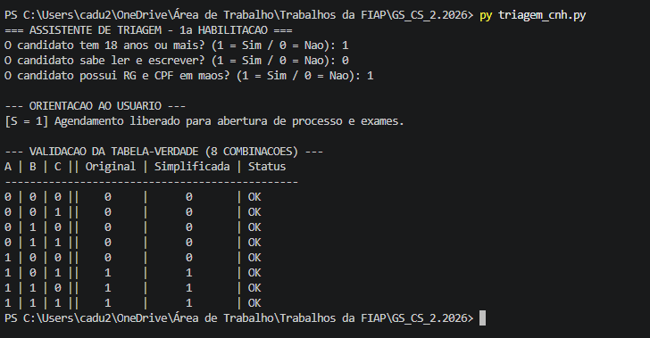

# Sistema de Triagem - 1a Via da CNH (Logica Booleana)

Trabalho desenvolvido para a disciplina de Computer Science. O objetivo é simular um atendimento básico de triagem usando lógica booleana, aplicando a tabela-verdade, simplificação algébrica, mapa de Karnaugh, circuitos lógicos e um script em Python para validação.

## Autores

| Nome | RM |
|---|---|
| Carlos Eduardo Affonso | 569676 |
| Igor Massone Monteiro | 573853 |

## Cenário e Regras

A situação escolhida foi a triagem inicial para tirar a **1a Via da CNH**. Definimos 3 variáveis de entrada e 1 de saída:

**Entradas:**
* **A (Maioridade):** `1` = 18 anos ou mais | `0` = Menor de 18 anos
* **B (Alfabetizacao):** `1` = Sabe ler e escrever | `0` = Não sabe ler e escrever
* **C (Documentos - RG e CPF):** `1` = Tem os dois | `0` = Falta algum documento

**Saida (S):**
* `S = 1` -> Agendamento liberado para abertura de processo e exames.
* `S = 0` -> Atendimento bloqueado (nao atende aos requisítos minimos).

**Regra definida pelo grupo:**
O agendamento só é liberado (`S = 1`) se o candidato for maior de idade (`A = 1`) **E** atender a pelo menos uma dessas condicoes: saber ler e escrever (`B = 1`, podendo usar documento digital caso esteja sem o fisico) **OU** estar com os documentos fisicos em mãos (`C = 1`, para atendimento assistido).

---

## 1. Tabela-Verdade

| A | B | C | Saida (S) | Mintermo |
| :-: | :-: | :-: | :-: | :-: |
| 0 | 0 | 0 | 0 | - |
| 0 | 0 | 1 | 0 | - |
| 0 | 1 | 0 | 0 | - |
| 0 | 1 | 1 | 0 | - |
| 1 | 0 | 0 | 0 | - |
| 1 | 0 | 1 | **1** | A . B' . C |
| 1 | 1 | 0 | **1** | A . B . C' |
| 1 | 1 | 1 | **1** | A . B . C |

---

## 2. Expressão Canônica e Simplificação

*(Obs: usando apóstrofo `'` para representar a negaçõo/NOT)*

### Soma de Mintermos (Forma Canônica)
Pegando as linhas onde `S = 1` (linhas 5, 6 e 7):

```text
S = (A . B' . C) + (A . B . C') + (A . B . C)
```

### Simplificação por Álgebra Booleana

```text
S = A.B'.C + A.B.C' + A.B.C
S = A . (B'.C + B.C' + B.C)        -> Distributiva (A em evidencia)
S = A . [B'.C + B.(C' + C)]        -> Distributiva (B em evidencia)
S = A . [B'.C + B.(1)]             -> Complemento (C' + C = 1)
S = A . (B'.C + B)                 -> Elemento neutro (B . 1 = B)
S = A . (B + C)                    -> Absorcao (X + X'.Y = X + Y)
```

**Equivalência com De Morgan:**
```text
S = ( (A . (B + C))' )'
S = ( A' + (B + C)' )'
S = ( A' + (B' . C') )'
```

### Mapa de Karnaugh

```text
       BC
A \   00  01  11  10
    +---+---+---+---+
  0 | 0 | 0 | 0 | 0 |
    +---+---+---+---+
  1 | 0 | 1 | 1 | 1 |
    +---+---+---+---+
```

* **Grupo 1 (colunas 01 e 11 na linha A=1):** `B` muda, sobra `A . C`
* **Grupo 2 (colunas 11 e 10 na linha A=1):** `C` muda, sobra `A . B`

Juntando os dois grupos:
```text
S = A.C + A.B  =>  S = A . (B + C)
```

---

## 3. Comparação dos Circuitos

Os circuitos foram montados e testados no **CircuitVerse** / **Logic.ly** (imagens na pasta `/circuitos`).

* **Circuito Original:** `S = A.B'.C + A.B.C' + A.B.C`
  * 2 portas NOT
  * 3 portas AND (de 3 entradas)
  * 1 porta OR (de 3 entradas)
  * **Total:** 6 portas logicas

* **Circuito Simplificado:** `S = A . (B + C)`
  * 0 portas NOT
  * 1 porta OR (de 2 entradas)
  * 1 porta AND (de 2 entradas)
  * **Total:** 2 portas lógicas (redução de 4 portas no circuito)

---

## 4. Código e Validação

O script `triagem.py` pede os valores de `A`, `B` e `C` no terminal (tratando caso o usuário digite algo diferente de `0` ou `1`), mostra o resultado do atendimento e roda um loop testando todas as 8 linhas da tabela-verdade para provar que a expressão original e a simplificada dão exatamente a mesma saida.

### Como rodar

Precisa ter o Python 3 instalado:

```bash
python triagem.py
```
## Evidências e Simulações

Abaixo estão os registros da tabela-verdade, da simplificação via Mapa de Karnaugh, dos circuitos montados no CircuitVerse e da execução do código em Python:

### 1. Tabela-Verdade


### 2. Mapa de Karnaugh


### 3. Circuito Lógico Original (6 portas)


### 4. Circuito Lógico Simplificado (2 portas)


### 5. Execução e Validação no Terminal



## Ferramentas usadas no trabalho
* **32x8.com** e **dCode** para conferir o mapa de Karnaugh e as simplificações.
* **CircuitVerse** para desenhar e testar as portas lógicas.
* **Python 3** para a implementação final.
